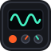
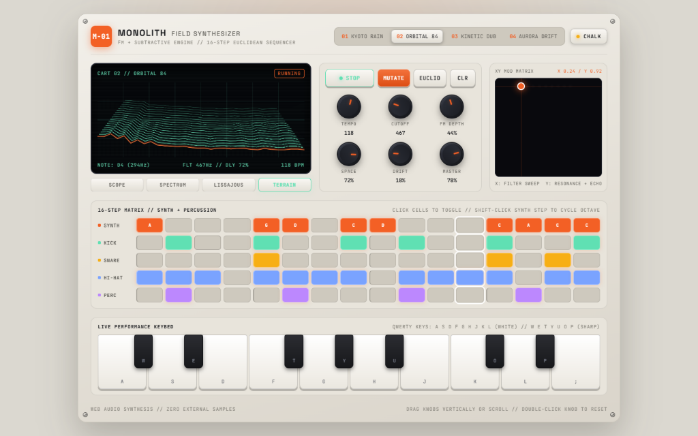

<div align="center">
  
  <h1>🎛️ MONOLITH M-01</h1>
  <p><strong>Tactile FM &amp; Subtractive Synthesizer · 16-Step Euclidean Sequencer · Real-Time OLED Visualizer</strong></p>

  <p>
    <a href="https://freddy47588.github.io/monolith-m01/">
      
    </a>
    
    
  </p>
</div>

<p align="center">
  
</p>

---

## ✨ Features

- 🔊 **100% Procedural Web Audio Engine** — Polyphonic FM + sub-oscillator synth voices, synthesized analog-style drums (`kick`, `snare`, `hi-hat`, `perc`), resonant lowpass filter, waveshaper saturation, stereo ping-pong delay, and master compressor. Zero external audio samples.
- 💾 **4 Sound Cartridges** — Hot-swap curated patches (`01 KYOTO RAIN`, `02 ORBITAL 84`, `03 KINETIC DUB`, `04 AURORA DRIFT`) with unique scales, waveforms, envelopes, and drum grooves.
- 🥁 **16-Step Euclidean Sequencer** — 5-track step matrix (`SYNTH`, `KICK`, `SNARE`, `HI-HAT`, `PERC`), Bjorklund Euclidean rhythm generator (`EUCLID`), and scale-locked sequence mutator (`MUTATE`).
- 📺 **Real-Time OLED Visualizer** — 4 Canvas 2D phosphor display modes: `SCOPE`, `SPECTRUM`, `LISSAJOUS`, and `TERRAIN`.
- 🎯 **XY Modulation Matrix** — Drag across the pad to sweep Filter Cutoff (`X`) and Resonance + Echo (`Y`) with glowing phosphor trails.
- 🎹 **Playable Keybed** — 17-key interactive piano bed supporting mouse/touch and QWERTY keyboard input.
- 🎨 **Dual Hardware Themes** — Toggle between dark studio `OBSIDIAN` and Braun-inspired light `CHALK`.

---

## 💿 Sound Cartridges

| Slot | Name | Tempo | Scale | Character |
| :---: | --- | :---: | --- | --- |
| `01` | 🌧️ **KYOTO RAIN** | `94 BPM` | Hirajoshi | Warm triangle + tape drift ambient groove |
| `02` | 🛰️ **ORBITAL 84** | `118 BPM` | Minor Pentatonic | Driving retro synthwave arpeggio |
| `03` | ⚡ **KINETIC DUB** | `126 BPM` | Dorian | Euclidean polyrhythm & resonant dub stabs |
| `04` | 🌌 **AURORA DRIFT** | `84 BPM` | Lydian | Crystalline FM shimmer & atmospheric pulse |

---

## 🎮 Controls

| Action | Control |
| --- | --- |
| ▶️ **Play / Stop** | Click `PLAY` or press `Space` |
| 🎹 **Play Live Notes** | Click keybed or use QWERTY (`A S D F G H J K L ;` white, `W E T Y U O P` sharp) |
| 🟩 **Toggle Step** | Click any cell in the 16-step matrix |
| 🎵 **Cycle Synth Note** | `Shift + Click` on a `SYNTH` step |
| 🎛️ **Adjust Knobs** | Drag vertically, scroll wheel, arrow keys, or double-click to reset |
| 🎲 **Generate Variation** | Click `MUTATE` (melody + drums) or `EUCLID` (drum density) |

---

## 🗂️ Project Structure

```text
monolith-m01/
├── index.html          # Hardware chassis layout & controls
├── styles.css          # Obsidian / Chalk themes & tactile hardware styling
├── app.js              # Sequencer, keybed, preset loader & UI bindings
├── assets/
│   ├── favicon.svg     # Vector app icon
│   └── preview.png     # UI screenshot
├── audio/
│   ├── engine.js       # Web Audio FM/subtractive synth & lookahead scheduler
│   └── presets.js      # Cartridges, scales & Bjorklund Euclidean generator
└── ui/
    ├── oled.js         # 4-mode Canvas 2D OLED visualizer
    ├── knobs.js        # Rotary encoder interactions
    └── xypad.js        # XY modulation pad with phosphor trails
```

---

## 🚀 Run Locally

Because the app uses native ES modules without any bundler, serve it with any static HTTP server:

```bash
python -m http.server 4173
```

Then open `http://localhost:4173` in your browser.
